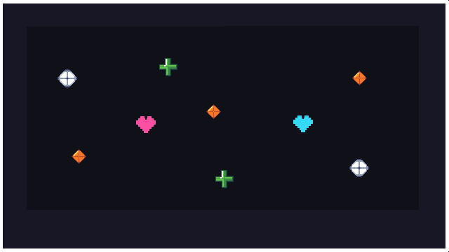

# TaleFor2 — Documento de Diseño del Videojuego

**Asignatura:** Juegos en Red  
**Grupo:** D  
**Integrantes:** Sebastián Soria, Benjamín Agüera y Marcos Varona

## Índice

1. [Introducción](#introducción)
2. [Ficha técnica](#ficha-técnica)
3. [Mecánicas](#mecánicas)
4. [Diseño visual](#diseño-visual)
   - [Personajes](#personajes)
   - [Obstáculos](#obstáculos)
   - [Escenario e interfaz](#escenario-e-interfaz)
   - [Recursos gráficos](#recursos-gráficos)
5. [Multijugador](#multijugador)
6. [Movimiento y colisiones](#movimiento-y-colisiones)
7. [Comunicación](#comunicación)
8. [Sonido](#sonido)
9. [Historia](#historia)
10. [Referencias](#referencias)

## Introducción

La idea para esta práctica es desarrollar un videojuego 2D de esquivar obstáculos, inspirado en juegos como *Undertale*. En este juego, dos jugadores deberán colaborar para esquivar distintos obstáculos que aparecerán en un pequeño espacio cerrado y sobrevivir durante 2 minutos.

La estética elegida será pixel-art, principalmente por su simpleza y sencillez.

## Ficha técnica

- **Nombre:** TaleFor2.
- **Género:** supervivencia cooperativa y esquiva de obstáculos.
- **Jugadores:** 2.
- **Plataforma:** ordenador, mediante navegador web.
- **Público objetivo:** mayores de 7 años.
- **Duración de la partida:** 120 segundos.
- **Estilo gráfico:** pixel-art en 2D.
- **Cámara:** fija, mostrando toda la arena.
- **Modalidad:** multijugador local inicialmente y multijugador en red en la versión final.

## Mecánicas

- Habrá dos jugadores, uno representado con un corazón de color magenta y otro con un corazón de color cian.
- El jugador 1 se controla con las teclas WASD, mientras que el jugador 2 se controla con las teclas Arriba, Abajo, Derecha e Izquierda.
- Ambos jugadores comparten una barra de salud de 20 puntos y una caja que delimita sus movimientos.
- Durante la partida, los jugadores se enfrentan a distintos ataques en forma de obstáculos que deben esquivar.
- Los efectos de los obstáculos varían dependiendo del color:
  - **Blanco:** quita 1 punto de salud.
  - **Verde:** recupera 1 punto de la salud compartida, sin superar el máximo de 20.
  - **Azul oscuro:** ralentiza durante 3 segundos al jugador que lo toca.
  - **Naranja:** ralentiza durante 3 segundos al otro jugador.
  - **Rojo:** quita 2 puntos de salud.
- Los obstáculos que ralentizan reducen la velocidad de movimiento del jugador afectado en un 30%.
- Durante la partida aparecerán power-ups asociados al color de cada jugador. Cada jugador únicamente podrá recoger los power-ups correspondientes a su color. Al recoger uno, ambos jugadores aumentarán su velocidad de movimiento un 30% durante 5 segundos.
- Cuando un jugador recibe daño de un obstáculo, entra en modo invencible durante 2 segundos, en los que no puede volver a recibir daño. En el modo invencible, el corazón se torna translúcido.
- Los obstáculos aparecen mediante patrones que se suceden de forma aleatoria.
- La partida tendrá una duración de **120 segundos (2 minutos)**. Cada 40 segundos aumentará la dificultad, incrementando progresivamente la velocidad de los obstáculos.
- Cuando la salud compartida llega a 0, ambos jugadores pierden la partida.
- Los jugadores ganan la partida si consiguen mantener la salud compartida por encima de 0 hasta que finalice el tiempo establecido.
- Al terminar la partida se mostrará una pantalla de victoria o derrota, con las opciones de jugar de nuevo o volver al menú inicial.

## Diseño visual

TaleFor2 tendrá una estética pixel-art sencilla, inspirada en juegos como *Undertale*. Se utilizarán colores llamativos sobre un fondo oscuro para facilitar la identificación de los jugadores y los obstáculos.

### Personajes

Los dos jugadores estarán representados por corazones de 32×32 píxeles:

- **Jugador 1:** corazón magenta (`#FF4FA3`).
- **Jugador 2:** corazón cian (`#36D9F5`).

Los corazones podrán desplazarse libremente dentro de los límites de la arena. Cuando un jugador reciba daño, su corazón se volverá translúcido durante los 2 segundos de invulnerabilidad.

### Obstáculos

Los obstáculos utilizarán sprites de aproximadamente 16×16 píxeles. Cada tipo tendrá un color y una forma diferente para facilitar su identificación:

- **Blanco (`#F2F2F5`):** proyectil en forma de rombo.
- **Verde (`#55D68A`):** cruz de curación.
- **Azul oscuro (`#2856B8`):** esfera que ralentiza al jugador.
- **Naranja (`#FF9F43`):** rombo que ralentiza al compañero.
- **Rojo (`#FF5964`):** estrella con puntas que provoca mayor daño.

### Escenario e interfaz

La partida tendrá lugar dentro de una arena rectangular con fondo oscuro. La cámara permanecerá fija para mostrar a ambos jugadores y los obstáculos en todo momento.

En la interfaz se mostrará la barra de salud compartida y el tiempo restante de la partida.

El menú principal permitirá comenzar una partida y acceder a las opciones disponibles. Al finalizar, aparecerá una pantalla de victoria o derrota con las opciones de volver a jugar o regresar al menú.

### Recursos gráficos

Los sprites del videojuego se han diseñado utilizando Aseprite y se exportan en formato PNG, manteniendo una estética pixel-art sencilla.

#### Sprites de los personajes

Los jugadores están representados por dos corazones de diferentes colores.

**Jugador 1 — Magenta**

**Jugador 2 — Cian**

#### Obstáculos

Los obstáculos utilizan diferentes colores y formas para identificar sus efectos durante la partida.

**Obstáculo blanco — Daño de 1 punto**

**Obstáculo verde — Recuperación de 1 punto de salud**

**Obstáculo naranja — Ralentización del compañero**

#### Escenario

La partida se desarrolla en una arena rectangular que delimita los movimientos de ambos jugadores.

## Multijugador

Inicialmente, el juego se desarrollará para dos jugadores en un mismo ordenador, compartiendo teclado y pantalla.

Posteriormente, se adaptará para que ambos jugadores puedan jugar desde diferentes ordenadores conectados mediante red, manteniendo sincronizados los movimientos, obstáculos, salud y tiempo restante de la partida.

## Movimiento y colisiones

Los jugadores podrán desplazarse libremente en cuatro direcciones dentro de una arena rectangular, sin atravesar sus límites.

Los obstáculos se moverán siguiendo diferentes patrones de ataque seleccionados aleatoriamente. Cuando un obstáculo entre en contacto con un jugador, se aplicará el efecto correspondiente según su color.

Después de recibir daño, el jugador tendrá 2 segundos de invulnerabilidad, durante los cuales no podrá perder más salud.

Cada 40 segundos aumentará la velocidad de los obstáculos, incrementando progresivamente la dificultad de la partida.

## Comunicación

TaleFor2 está dirigido a jugadores que disfrutan de los videojuegos cooperativos y las partidas cortas.

Para dar a conocer el proyecto, se compartirán capturas de pantalla, vídeos cortos de las partidas y avances del desarrollo.

Además, el repositorio de GitHub permitirá mostrar la documentación, los recursos gráficos y la evolución del videojuego.

## Sonido

TaleFor2 contará con música de fondo de estilo retro de 8 bits, acorde con su estética pixel-art. Durante la partida se utilizará una melodía dinámica que acompañará los diferentes patrones de obstáculos.

También se incluirán efectos sonoros para las principales acciones del juego:

- **Daño:** sonido breve cuando un jugador pierde salud.
- **Curación:** sonido al recuperar puntos de salud.
- **Potenciadores:** efecto al recoger un objeto que aumenta la velocidad.
- **Victoria:** melodía corta al sobrevivir los 120 segundos.
- **Derrota:** sonido que indica que la salud compartida ha llegado a cero.

## Historia

En las tierras de Unrelated, los héroes Papyrus Y Sans se adentran en territorios oscuros y malévolos. En su viaje, se encuentran un malvado hechicero que enfrasca a ambos en un retorcido juego en el que deberán esquivar juntos trampas mortales hasta agotar las fuerzas mágicas de mago.

## Referencias

- **Undertale — Toby Fox (2015).** Videojuego utilizado como inspiración para las mecánicas de esquivar obstáculos, la representación de los personajes mediante corazones y la estética pixel-art. https://undertale.com/

- **Aseprite.** Herramienta utilizada para diseñar los sprites y recursos gráficos del videojuego. https://www.aseprite.org/