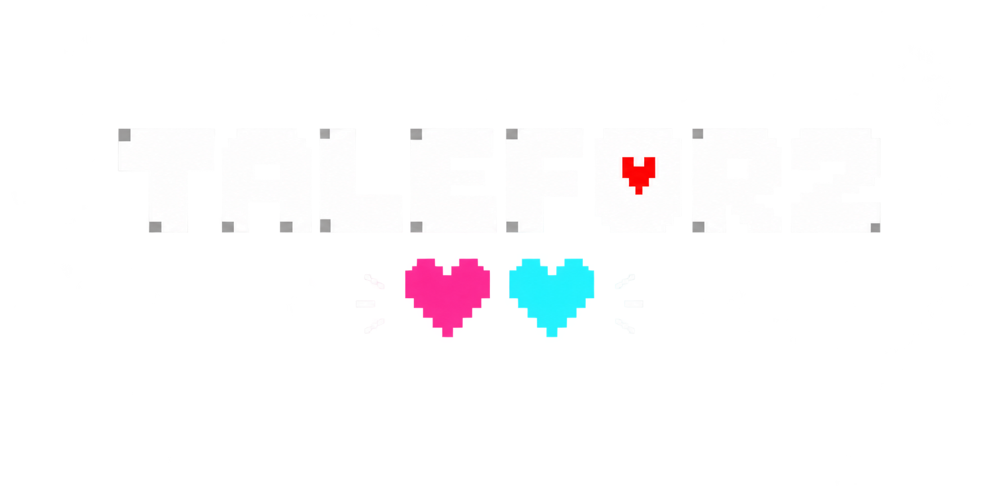

# TaleFor2 — Documento de Diseño del Videojuego

**Asignatura:** Juegos en Red  
**Grupo:** D  
**Integrantes:** Sebastián Soria, Benjamín Agüera y Marcos Varona  
**Fase:** 2 — Implementación del videojuego local.

## Índice

1. [Introducción](#introducción)
2. [Ficha técnica](#ficha-técnica)
3. [Mecánicas](#mecánicas)
4. [Diseño visual](#diseño-visual)
   - [Personajes](#personajes)
   - [Obstáculos](#obstáculos)
   - [Escenario e interfaz](#escenario-e-interfaz)
   - [Recursos gráficos](#recursos-gráficos)
5. [Multijugador](#multijugador)
6. [Movimiento y colisiones](#movimiento-y-colisiones)
7. [Comunicación](#comunicación)
8. [Sonido](#sonido)
9. [Historia](#historia)
10. [Referencias](#referencias)

## Introducción

La idea para esta práctica es desarrollar un videojuego 2D de esquivar obstáculos, inspirado en juegos como **Undertale**. En este juego, dos jugadores deberán colaborar para esquivar distintos obstáculos que aparecen en un pequeño espacio cerrado y sobrevivir durante 2 minutos.

La principal característica del videojuego es que ambos jugadores comparten una única barra de salud, por lo que las acciones de cada jugador afectan directamente al resultado del equipo.

La estética elegida es pixel-art, principalmente por su simpleza y sencillez.

## Ficha técnica

- **Nombre:** TaleFor2.
- **Género:** supervivencia cooperativa y esquiva de obstáculos.
- **Jugadores:** 2.
- **Plataforma:** ordenador, mediante navegador web.
- **Público objetivo:** mayores de 7 años.
- **Duración de la partida:** 120 segundos.
- **Estilo gráfico:** pixel-art en 2D.
- **Cámara:** fija, mostrando toda la arena.
- **Modalidad actual:** multijugador local.
- **Modalidad futura:** multijugador en red.
- **Motor:** Phaser 3.

## Mecánicas

- Hay dos jugadores, uno representado con un corazón de color magenta y otro con un corazón de color cian.
- El jugador 1 se controla con las teclas WASD, mientras que el jugador 2 se controla con las flechas direccionales.
- Ambos jugadores comparten una barra de salud de 20 puntos y una caja que delimita sus movimientos.
- Durante la partida aparecen diferentes obstáculos que los jugadores deben esquivar o aprovechar dependiendo de sus efectos.
- Los efectos de las flechas varían dependiendo del color:
  - **Blanco:** quita 1 punto de salud.
  - **Verde:** recupera 1 punto de salud compartida.
  - **Rojo:** quita 2 puntos de salud.
  - **Azul:** ralentiza al jugador que lo toca.
  - **Naranja:** ralentiza al otro jugador.
  - **Amarillo:** acelera al jugador que lo toca.
  - **Rosa:** acelera al otro jugador.
- Los obstáculos que ralentizan reducen la velocidad del jugador afectado al 50% durante 3 segundos.
- Los obstáculos de aceleración multiplican por 3 la velocidad del jugador afectado durante 3 segundos.
- Cuando un jugador recibe daño, entra en modo invencible durante 2 segundos. Durante este periodo, el corazón parpadea.
- Las flechas aparecen desde los laterales de la pantalla y apuntan hacia uno de los jugadores seleccionado aleatoriamente, con una pequeña desviación.
- También aparecen obstáculos en forma de barras que se desplazan horizontal o verticalmente.
- La dificultad aumenta progresivamente mediante el incremento de la cantidad de flechas generadas y la probabilidad de aparición de flechas especiales.
- Las flechas de curación tienen una probabilidad de aparición inferior a otros obstáculos especiales.
- La partida tiene una duración de **120 segundos (2 minutos)**.
- Cuando la salud compartida llega a 0, ambos jugadores pierden la partida.
- Los jugadores ganan si consiguen mantener la salud compartida por encima de 0 hasta que finalice el tiempo establecido.
- La partida puede pausarse y reanudarse mediante la tecla ESC.
- Al terminar la partida se muestra una pantalla de victoria o derrota, con las opciones de jugar de nuevo o volver al menú inicial.

## Diseño visual

TaleFor2 tiene una estética pixel-art sencilla, inspirada en juegos como Undertale. Se utilizan colores llamativos sobre un fondo oscuro para facilitar la identificación de los jugadores y los obstáculos.

### Personajes

Los dos jugadores están representados por corazones:

- **Jugador 1:** corazón magenta.
- **Jugador 2:** corazón cian.

Los corazones pueden desplazarse libremente dentro de los límites de la arena.

Cuando un jugador recibe daño, su corazón parpadea durante los 2 segundos de invulnerabilidad.

Los efectos de ralentización y aceleración también producen cambios visuales en el jugador afectado.

### Obstáculos

Existen dos tipos principales de obstáculos:

**Flechas**

Las flechas utilizan un mismo sprite, cuyo color cambia dependiendo del efecto que producen.

- Blanco: daño normal.
- Verde: curación.
- Rojo: daño aumentado.
- Azul: ralentización propia.
- Naranja: ralentización del compañero.
- Amarillo: aceleración propia.
- Rosa: aceleración del compañero.

**Barras**

Son obstáculos de mayor tamaño que aparecen con menor frecuencia y se desplazan horizontal o verticalmente dentro de la pantalla.

Su tamaño y movimiento dificultan el desplazamiento de los jugadores por la arena.

### Escenario e interfaz

La partida tiene lugar dentro de una arena rectangular con fondo oscuro. La cámara permanece fija para mostrar a ambos jugadores y los obstáculos en todo momento.

La resolución del videojuego es de 800 × 600 píxeles.

La interfaz muestra:

- Barra de salud compartida de color morado.
- Contador numérico de salud.
- Temporizador con el tiempo restante.
- Cambio del color del temporizador durante los últimos 10 segundos.

El videojuego cuenta con cuatro escenas:

- **MenuScene:** menú principal.
- **GameScene:** desarrollo de la partida.
- **PauseScene:** menú de pausa.
- **EndScene:** pantalla de victoria o derrota.

### Recursos gráficos

Los recursos gráficos se utilizan en formato PNG, manteniendo una estética pixel-art sencilla.

#### Sprites de los personajes

**Jugador 1 — Magenta**

**Jugador 2 — Cian**

#### Obstáculos

**Flecha**

**Barra**

#### Pantallas

**Menú principal**

**Victoria**

**Derrota**

## Multijugador

En la Fase 2, el videojuego permite que dos jugadores jueguen en un mismo ordenador, compartiendo teclado y pantalla.

Ambos jugadores disponen de controles independientes, pero comparten la salud y el objetivo de supervivencia.

Posteriormente, se plantea adaptar el videojuego para que ambos jugadores puedan jugar desde diferentes ordenadores conectados mediante red, manteniendo sincronizados los movimientos, obstáculos, salud y tiempo restante de la partida.

## Movimiento y colisiones

Los jugadores pueden desplazarse libremente dentro de una arena rectangular, sin atravesar sus límites.

El movimiento se normaliza para evitar que los desplazamientos diagonales sean más rápidos que los horizontales o verticales.

Las colisiones se gestionan mediante el sistema Arcade Physics de Phaser.

Cuando un obstáculo entra en contacto con un jugador, se ejecuta el efecto correspondiente según su tipo.

Después de recibir daño, el jugador dispone de 2 segundos de invulnerabilidad, durante los cuales no puede perder más salud.

La generación de obstáculos se gestiona mediante la clase Obstacle_Manager.

La dificultad aumenta mediante la generación progresiva de más flechas por intervalo y el incremento de la probabilidad de aparición de obstáculos especiales.

Los obstáculos que salen de los límites de la pantalla se eliminan para evitar su acumulación.

## Comunicación

TaleFor2 está dirigido a jugadores que disfrutan de los videojuegos cooperativos y las partidas cortas.

Para dar a conocer el proyecto, se pueden compartir capturas de pantalla, vídeos cortos de las partidas y avances del desarrollo.

Además, el repositorio de GitHub permite mostrar la documentación, los recursos gráficos y la evolución del videojuego.

## Sonido

TaleFor2 cuenta con música de fondo en el menú principal y efectos sonoros asociados a las principales acciones del videojuego:

- **Inicio:** sonido al comenzar una partida.
- **Daño:** sonido cuando un jugador pierde salud.
- **Curación:** sonido al recuperar puntos de salud.
- **Ralentización:** sonido al recibir un efecto de reducción de velocidad.
- **Aceleración:** sonido al recibir un efecto de aumento de velocidad.
- **Derrota:** sonido cuando la salud compartida llega a cero.

La gestión del sonido se realiza mediante la clase SoundManager, que permite reproducir música, efectos sonoros, controlar el volumen y silenciar el videojuego.

## Historia

En las tierras de Unrelated, los héroes Papyrus y Sans se adentran en territorios oscuros y malévolos. En su viaje, se encuentran con un malvado hechicero que enfrasca a ambos en un retorcido juego en el que deberán esquivar juntos trampas mortales hasta agotar las fuerzas mágicas del mago.

## Referencias

- **Undertale — Toby Fox (2015).** Videojuego utilizado como inspiración para las mecánicas de esquivar obstáculos, la representación de los personajes mediante corazones y la estética pixel-art. https://undertale.com/

- **Aseprite.** Herramienta utilizada para diseñar sprites y recursos gráficos del videojuego. https://www.aseprite.org/

- **Phaser 3.** Framework utilizado para el desarrollo del videojuego. https://phaser.io/

- **Vite.** Herramienta utilizada para el entorno de desarrollo. https://vite.dev/
